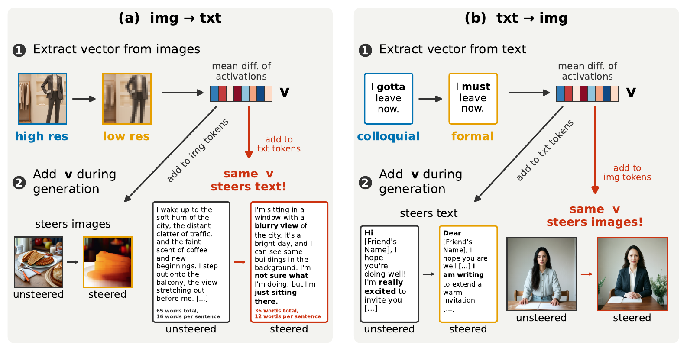

# cross-modal-steering

Code for **"Cross-Modal Steering Vectors Exist Across Both Image and Text Generation"**: extract steering vectors from
text or image minimal pairs and apply them to text and image generation in UniAR, Emu3.5 and Liquid.



A steering vector extracted entirely from one modality steers generation both within that modality and,
without any adaptation, in the other.

## Install

```bash
pip install -e .                 # analysis and figures (CPU)
pip install -e ".[judge]"        # + the Gemini judges (concept rate, fluency, coherence)
pip install -e ".[dreamsim]"     # + the DreamSim pole score
pip install -e ".[uniar]"        # + UniAR, the model the examples below use
```

Copy `.env.example` to `.env`, fill in what you need, and load it:

```bash
set -a
source .env
set +a
```

| variable | needed for |
|---|---|
| `GEMINI_API_KEY` | `cmsteer judge` |
| `UNIAR_CKPT` | UniAR (optional, defaults to the Hub id) |

Liquid and Emu3.5 work the same way (`--model liquid`, `--model emu35`), each in its own environment
(`.[liquid]`, `.[emu35]`); `.env.example` lists what they need.

## Quick start

Rebuild the paper's tables and figures from the released scores (CPU, about a minute):

```bash
cmsteer results --out results/
```

Try one steered generation:

```bash
cmsteer steer --model uniar --concept emotion --alpha 40            # text
cmsteer steer --model uniar --concept emotion --alpha 9 --image     # image
```

## Full pipeline

```bash
cmsteer extract --model uniar --out runs/uniar/vectors                        # 1. vectors from minimal pairs
cmsteer sweep   --config uniar --out runs/uniar --vectors runs/uniar/vectors  # 2. steered generations
cmsteer judge   --run runs/uniar                                              # 3. score with Gemini
cmsteer results --root runs --models uniar --out results/uniar                # 4. tables and figures
```

Skip step 1 with `--vectors release` to use the released vectors. To run a small slice, add for example
`--concepts emotion --layer-configs mid --n-prompts 2` to `sweep`.

Optional output-quality scores, picked up by `cmsteer results`:

```bash
cmsteer judge --run runs/uniar --metric fluency                     # text fluency (Gemini)
cmsteer judge --run runs/uniar --metric coherence                   # image coherence, middle layers (Gemini)
cmsteer judge --run runs/uniar --metric dreamsim --refs <refs dir>  # DreamSim pole score
```

DreamSim compares each image with a positive- and a negative-pole reference of its prompt, stored as
`<refs dir>/<concept>/p<NN>_{pos,neg}.png`.

## Commands

| command | what it does | main options |
|---|---|---|
| `cmsteer results` | tables and figures from judge scores | `--out`, `--root`, `--models` |
| `cmsteer extract` | steering vectors from minimal pairs | `--model`, `--out`, `--concepts`, `--modalities`, `--pairs` |
| `cmsteer sweep` | steered generations for a config | `--config`, `--out`, `--vectors`, `--media`, `--concepts`, `--quadrants`, `--layer-configs`, `--n-prompts`, `--dry-run` |
| `cmsteer judge` | score a sweep: concept rate (default), fluency, coherence or DreamSim | `--run`, `--metric`, `--media`, `--workers`, `--limit`, `--refs` |
| `cmsteer steer` | one unsteered and one steered output | `--model`, `--concept`, `--alpha`, `--source`, `--layers`, `--image`, `--prompt` |

`cmsteer <command> --help` lists every option. Sweeps resume where they stopped.

## Python API

```python
from cmsteer import hub
from cmsteer.models import load_model
from cmsteer.steering import Steer
from cmsteer.vectors import load_vector

model = load_model("uniar")
v = load_vector(hub.fetch("uniar", ["vectors"]) / "vectors/emotion/txt.pt")   # [n_layers, hidden]
steer = Steer(v, layers=[16, 17, 18, 19], alpha=9.0)          # adds alpha * unit(v) at these layers

# images: one Steer (or None) per prompt
images = model.generate_images(["A portrait of a person in a park."] * 2, [None, steer])

# text: `spans` is the phrase of each prompt that is steered, along with every generated token
msg = "Describe your day in the city. Your description must include a dog."
texts = model.generate_text([msg], spans=["a dog"], steer=[Steer(v, [16, 17, 18, 19], alpha=-40.0)])
```

See `examples/` for adding a concept or a model.

## Configs

`configs/{uniar,emu35,liquid}.yaml` define a model's sweep: concepts, layer configurations, the strength grid of each
setting, decoding arguments and batch sizes. Pass a model name or your own YAML to `--config`.

Settings are named `<vector source>2<output>`: `txt2txt`, `img2txt`, `img2img`, `txt2img`.

## Outputs

```
runs/<model>/
  vectors/<concept>/{txt,img}.pt
  generations/sweep_{text,image}.csv        concept, quadrant, config, alpha, prompt_idx, prompt, output | image_path
  generations/images/<concept>/*.png
  judge/verdicts_{text,image}.jsonl
  judge/concept-rate_scores.csv             concept, quadrant, config, alpha, prompt_idx, verdict, correct
```

The released data has the same layout: one Hugging Face dataset per model, plus one for the minimal pairs.

## License

MIT. The vendored UniAR code under `src/cmsteer/models/_vendor/uniar/` is Apache-2.0.
